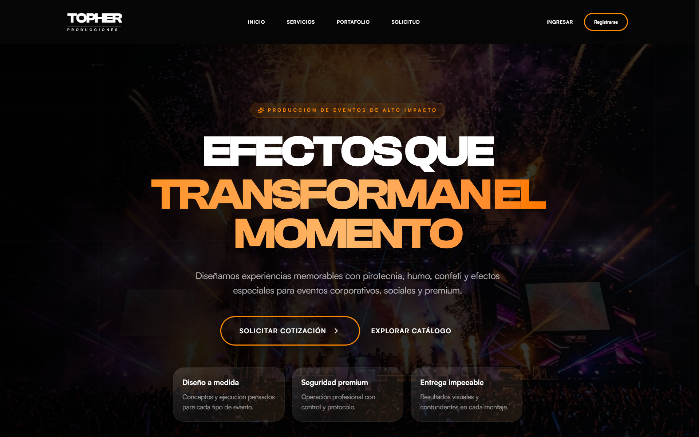

<!--
  PLANTILLA DE REFERENCIA
  Este es un ejemplo de README profesional. Puedes usarlo como base o seguir otro formato.
  Cómo usarlo: copia este archivo en la raíz de tu repo con el nombre README.md
  y reemplaza todo lo que está entre [corchetes] con la información de tu proyecto.
  Borra las secciones que no apliquen. (Este comentario no se ve en GitHub.)
-->

# [proyecto TOPHER]

> [aplicacion web para la empresa TOPHER producciones, dedeicada a la produccion y ejecucion de shows de efectos especiales y pirotecnia profesional para eventos]



## 📌 El problema
[el proyecto TOPHER resuelve el problema de falta de visualizacion web a la empresa TOPHER producciones.]

## ✅ La solución
[2 o 3 líneas: cómo lo resuelve tu proyecto.]

**Funcionalidades principales:**
- [reserva de servicios]
- [portafolio de eventos]
- [contacto con la empresa]

## 🛠️ Tecnologías
| Capa | Tecnología |
|---|---|
| Frontend | [React bit,Javascript,html] |
| Backend | [Django,PYTHON] |
| Base de datos | [MariaDB] |
| Otras | [Git, GitHub,versel,railway] |

## 🏗️ Arquitectura
[Explica en pocas líneas cómo se conectan las partes, o pon un diagrama.]

```
[Usuario] → [Frontend] → [Backend] → [Base de datos]
```

## 🚀 Cómo ejecutarlo
**Requisitos:** Windows, Git, XAMPP con MySQL/MariaDB, Python 3.11 y Node.js 22.12 o superior.

### 1. Clonar el repositorio

Abre PowerShell y ejecuta:

```powershell
git clone https://github.com/Mondongo202453/proyecto_thoper.git
Set-Location proyecto_thoper
```

### 2. Iniciar e importar la base de datos local

1. Abre el panel de XAMPP e inicia **Apache** y **MySQL** (Apache permite abrir phpMyAdmin).
2. Entra a [http://localhost/phpmyadmin](http://localhost/phpmyadmin) y selecciona **Importar**.
3. Elige `database/topher_db.sql` dentro de la carpeta del proyecto y pulsa **Importar**. El archivo crea la base `topher_db`.

### 3. Configurar el backend

Crea el archivo local de variables de entorno y ábrelo para editar:

```powershell
Copy-Item .\backend\.env.example .\backend\.env
notepad .\backend\.env
```

En `backend/.env`, confirma que la base coincida con la importada (`DB_NAME=topher_db`) y ajusta `DB_USER`, `DB_PASSWORD`, `DB_HOST` y `DB_PORT` a tu instalación de XAMPP. Reemplaza también `SECRET_KEY` por una clave de desarrollo propia. No subas el archivo `.env` ni credenciales reales al repositorio.

Desde la carpeta raíz del proyecto, instala las dependencias y aplica las migraciones:

```powershell
py -3.11 -m venv backend\env
& .\backend\env\Scripts\python.exe -m pip install --upgrade pip
& .\backend\env\Scripts\python.exe -m pip install -r .\backend\requirements.txt
& .\backend\env\Scripts\python.exe .\backend\manage.py migrate
```

Inicia el backend:

```powershell
& .\backend\env\Scripts\python.exe .\backend\manage.py runserver 127.0.0.1:8000
```

Déjalo abierto en esa terminal. Para detenerlo, usa `Ctrl+C`.

### 4. Iniciar el frontend

Abre una segunda ventana de PowerShell, sitúate en la carpeta raíz del proyecto e inicia Vite:

```powershell
Set-Location .\frontend
npm ci
npm run dev
```

Abre la dirección que Vite muestra en la terminal (normalmente [http://localhost:5173](http://localhost:5173)). El frontend usa por defecto la API local `http://127.0.0.1:8000/api`. Para detenerlo, usa `Ctrl+C`.

**Demo:** [Enlace al proyecto desplegado o al video funcionando]

## 📸 Capturas
| Pantalla | Descripción |
|---|---|
|  | [Qué se ve] |
|  | [Qué se ve] |

## 👥 Equipo
| Nombre | Rol | GitHub |
|---|---|---|
| [daniel bustos] | [frontend, base de datos] | [@Mondongo202453] |
| [julian presiga] | [backend] | [@presiga84] |
| [cristian vasquez] | [backend] | [@crixx3101] |
| [juanpablo velilla] | [base de datos] | [@velilla07] |

## 📄 Contexto
Proyecto formativo del programa **Análisis y Desarrollo de Software (ADSO)** · SENA · [Centro] · [Año].

---

### Lo que mira un líder técnico o un jurado en los primeros 2 minutos
1. ¿Entiendo **qué hace** el proyecto en la primera línea?
2. ¿Hay **capturas o un video** que lo muestren funcionando?
3. ¿Puedo **ejecutarlo** siguiendo las instrucciones, sin preguntarle a nadie?
4. ¿Se ve **ordenado**: carpetas claras, sin archivos basura, commits con buenos mensajes?
5. ¿Sé **quién hizo qué**?
